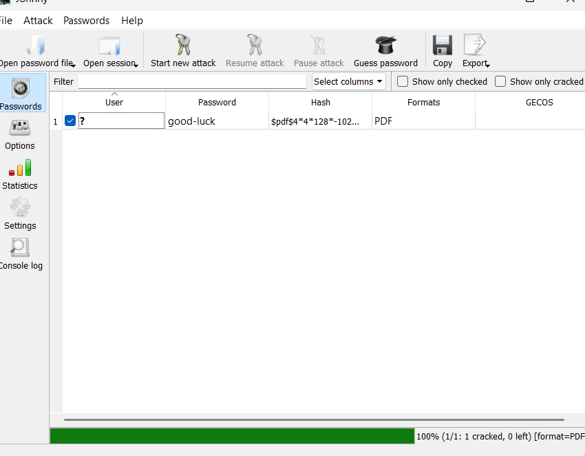
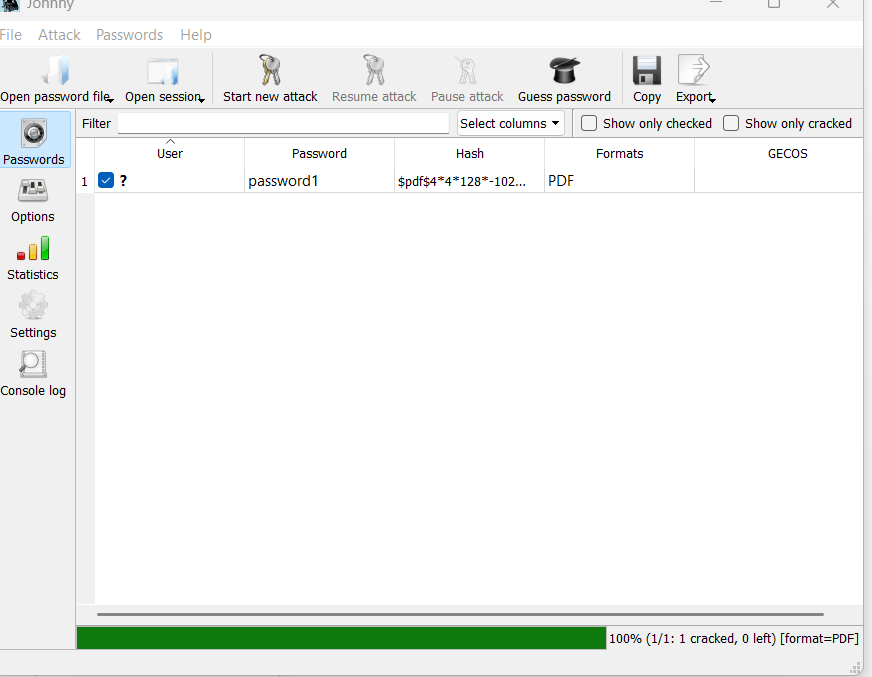
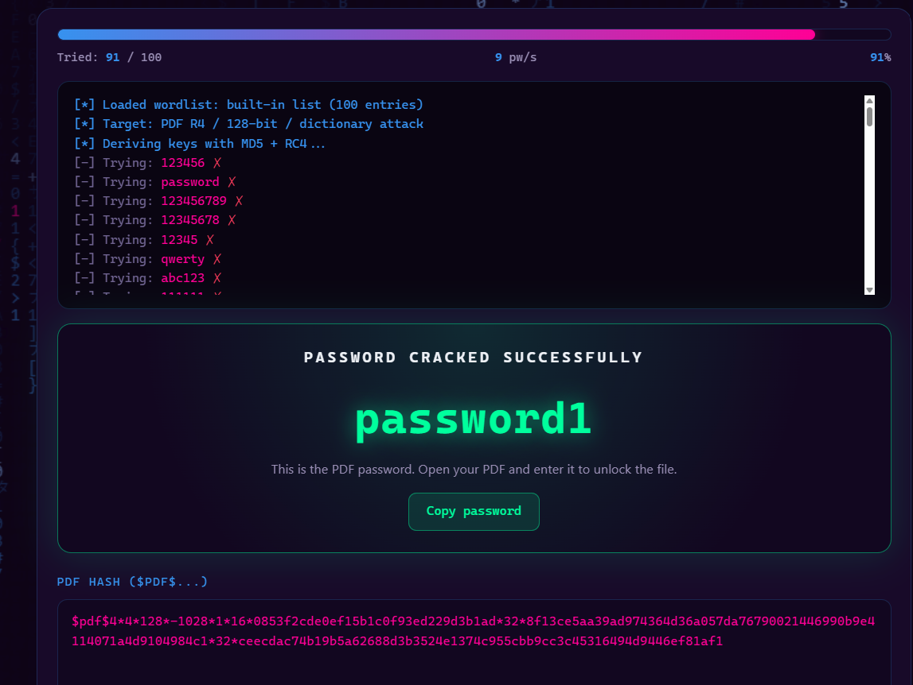
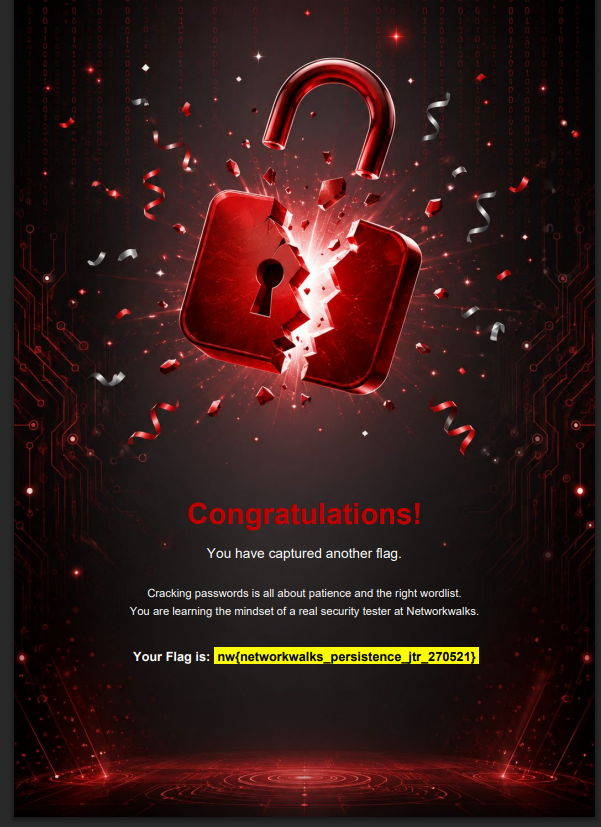
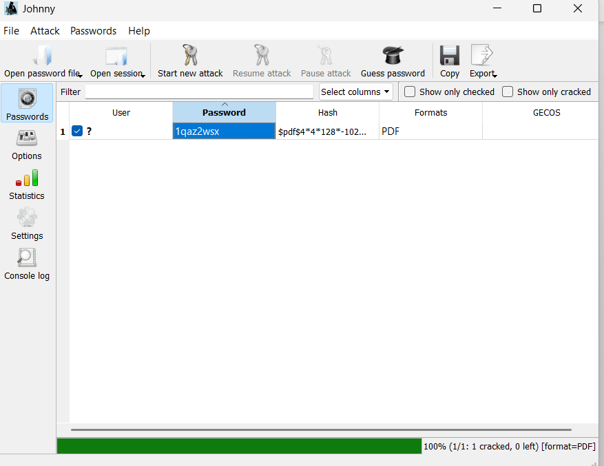
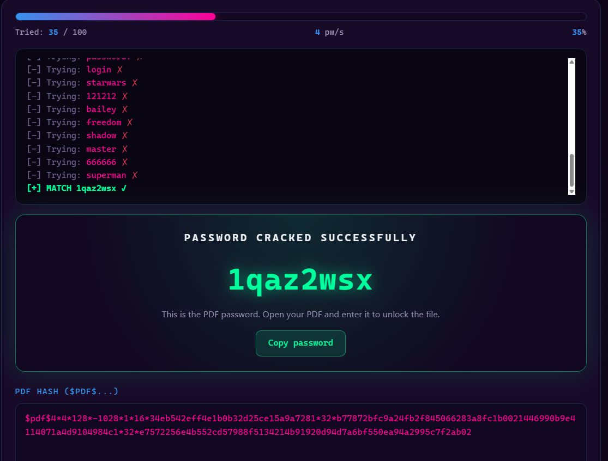
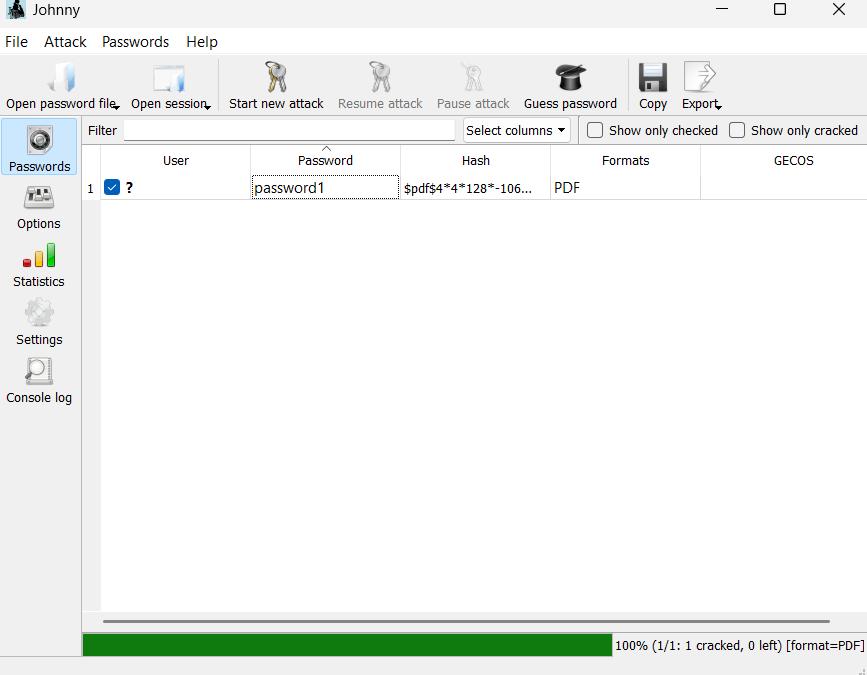
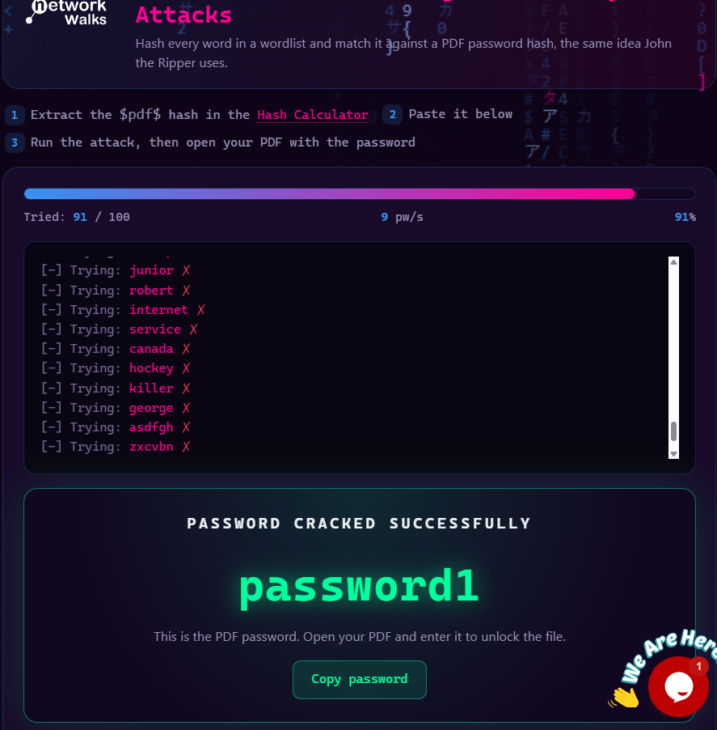
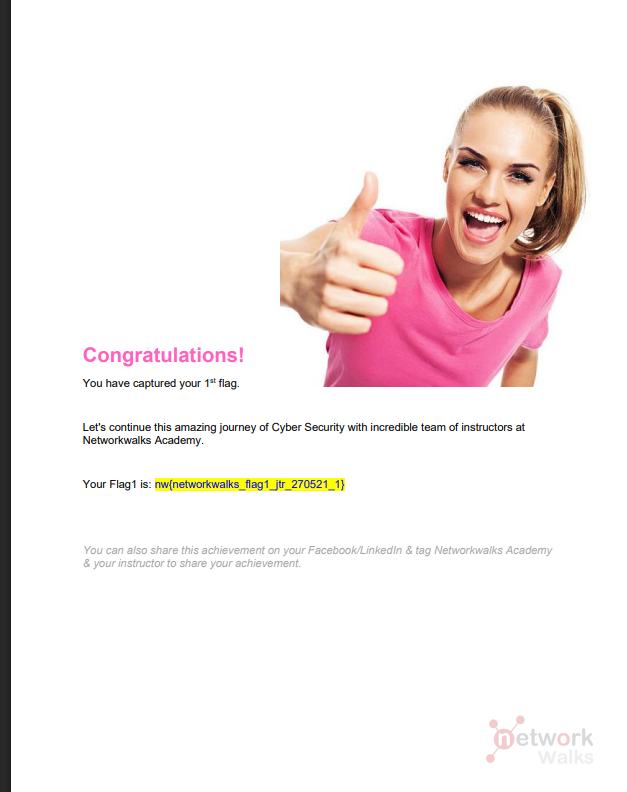

# Week 3 – Password Cracking with John the Ripper & Networkwalks Tools

Cybersecurity & Ethical Hacking — Networkwalks Academy
Modules: **W3-PM1 (Password Cracking with JTR)** and **W3-PM2 (Password Cracking with Networkwalks Tools)**

## Overview

This repo documents how I recovered the passwords on four protected PDFs. Each PDF's
password hash was extracted, then cracked two ways as required by the two essential
modules:

- **W3-PM1** — using **John the Ripper**, via its GUI front-end **Johnny**, on Windows.
- **W3-PM2** — using Networkwalks' own browser-based **Hash Calculator / Attacks**
  tool, which hashes a built-in wordlist and matches it against the same `$pdf$` hash.

Each cracked PDF revealed a "Congratulations" page containing a unique flag.

## Steps followed

1. Extracted the password hash from each locked PDF using `pdf2john`, producing
   `hash1.txt` – `hash4.txt` (included in this repo).
2. **JTR (Johnny):** loaded each hash into Johnny (`Open password file`) and ran a
   wordlist attack until Johnny reported `1/1 cracked, 0 left`.
3. **Networkwalks Tools:** pasted the same hash into the NW "Hash Calculator →
   Attacks" page, which hashes a 100-word built-in list and matches it against the
   `$pdf$` hash, confirming the same password.
4. Used the recovered password to unlock the matching PDF, revealing the flag.

## Results

| Task | Hash file | Cracked password | Cracked with | Flag |
|------|-----------|-------------------|---------------|------|
| 1 | `hash1.txt` | `good-luck` | JTR (Johnny) | `nw{cybersecurity_flag_captured_2608}` |
| 2 | `hash2.txt` | `password1` | JTR (Johnny) + NW Tools | `nw{networkwalks_persistence_jtr_270521}` |
| 3 | `hash3.txt` | `1qaz2wsx` | JTR (Johnny) + NW Tools | `nw{networkwalks_flag_260821_1}` |
| 4 | `hash4.txt` | `password1` | JTR (Johnny) + NW Tools | `nw{networkwalks_flag1_jtr_270521_1}` |

Both tools returned identical passwords for every hash they were both run against,
confirming the result.

## Screenshots

### Task 1 — hash1.txt → `good-luck`

**Johnny (JTR):**

**Flag:**

### Task 2 — hash2.txt → `password1`

**Johnny (JTR):**

**Networkwalks Tools:**

**Flag:**

### Task 3 — hash3.txt → `1qaz2wsx`

**Johnny (JTR):**

**Networkwalks Tools:**

**Flag:**

### Task 4 — hash4.txt → `password1`

**Johnny (JTR):**

**Networkwalks Tools:**

**Flag:**

## Files in this repo

| File | What it shows |
|---|---|
| `hash1.txt` – `hash4.txt` | The `$pdf$` password hash extracted from each PDF |
| `task1_hash1_johnny_cracked.png` | Johnny (JTR) cracking hash1 → `good-luck` |
| `task2_hash2_johnny_cracked.png` | Johnny (JTR) cracking hash2 → `password1` |
| `task3_hash3_johnny_cracked.png` | Johnny (JTR) cracking hash3 → `1qaz2wsx` |
| `task4_hash4_johnny_cracked.png` | Johnny (JTR) cracking hash4 → `password1` |
| `task2_hash2_nwtools_cracked.png` | Networkwalks Attacks tool cracking hash2 → `password1` |
| `task3_hash3_nwtools_cracked.png` | Networkwalks Attacks tool cracking hash3 → `1qaz2wsx` |
| `task4_hash4_nwtools_cracked.png` | Networkwalks Attacks tool cracking hash4 → `password1` |
| `task1_flag.png` – `task4_flag.png` | The "Congratulations" flag page for each task |

## Reflection

Every password recovered here came straight from a common wordlist (`password1`,
`1qaz2wsx`, `good-luck`) and cracked almost instantly, with both tools agreeing on
the same result. This is a clear demonstration of why:

- **Short, common, or keyboard-pattern passwords** (`1qaz2wsx` is a keyboard-walk)
  offer almost no real protection once an attacker has the hash.
- **Offline attacks are fast** — there's no lockout or rate-limit once a hash is in an
  attacker's hands, so the only real defence is password strength/entropy.
- **Defences that actually help:** long random passphrases, password managers,
  salting + strong hashing (already present here via the PDF's own hash scheme), and
  multi-factor authentication so a cracked password alone isn't enough.

## Tools used

- [John the Ripper](https://www.openwall.com/john/) / `pdf2john`
- [Johnny](https://openwall.info/wiki/john/johnny) (GUI front-end for JtR)
- Networkwalks' Hash Calculator / Attacks tool (PM2)

## Disclaimer

All files cracked in this repo are training material provided by Networkwalks
Academy for educational purposes only. No real-world systems or third-party data
were involved.
